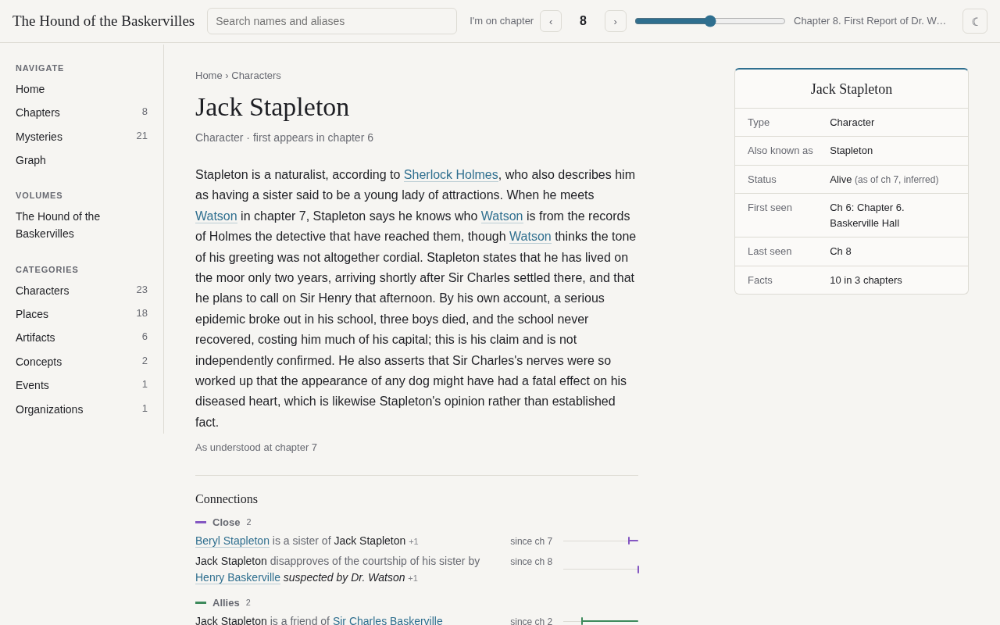
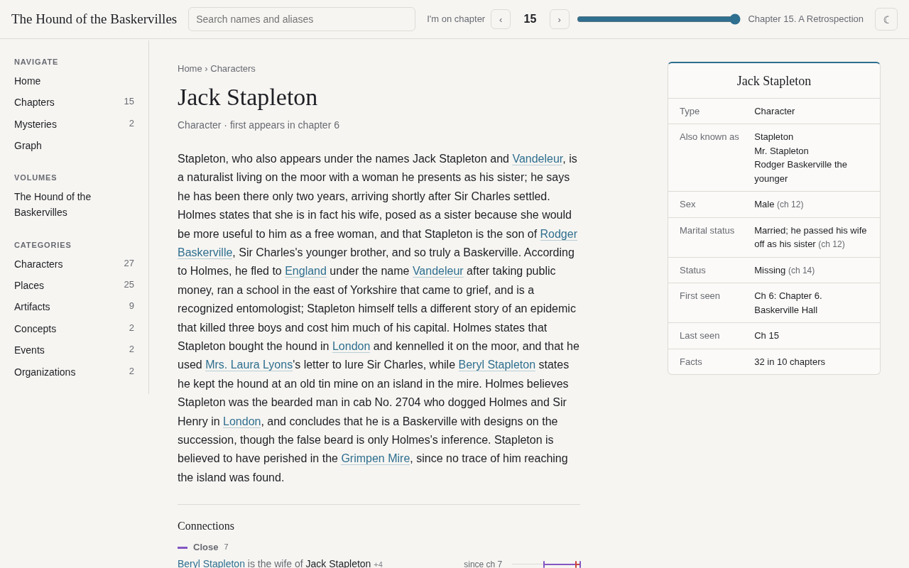
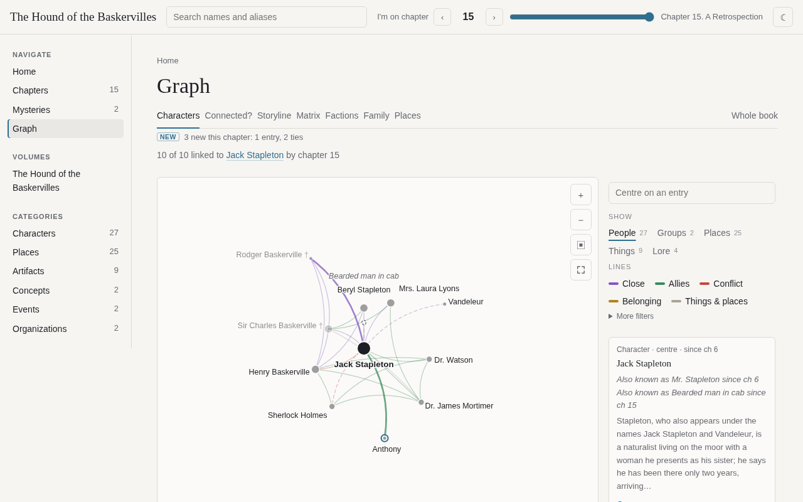

# Annalist

[](https://github.com/gravewhisper/annalist/actions/workflows/tests.yml)
[](pyproject.toml)
[](pyproject.toml)
[](LICENSE)

**Turn an epub novel into a spoiler-safe wiki.** An LLM reads the book one chapter at a time, as a first-time reader would, and records the characters, places and things, facts with quotes, relations, and the mysteries the story raises. Set the slider to the chapter you just finished, and the wiki shows only what the book has told you so far.

**[Try the live demo](https://gravewhisper.github.io/annalist/)**, a wiki of *The Hound of the Baskervilles*. Move the chapter slider and watch the spoilers disappear.

| Slider at chapter 8 | Slider at chapter 15 |
|---|---|
|  |  |

<sub>The same page in a wiki of <i>The Hound of the Baskervilles</i>. At chapter 8, Stapleton is a friendly naturalist. At chapter 15, the wiki knows who he really is.</sub>

## Features

- **No spoilers.** Every entry, alias, fact, relation, and answer is dated to the chapter that first shows it, and the site hides it until you get there. A test renders every page at every chapter and fails on any word from a later one.
- **Every fact has a quote.** Code checks each quote against the chapter text, so the wiki cannot cite a line the book does not contain.
- **Mysteries.** Open questions are tracked from the chapter that raises them to the chapter that answers them, with partial leads along the way.
- **Graph.** Strongest ties, paths between two entries, a storyline view, factions, family trees, and places.
- **Infoboxes over time.** Status, affiliation, occupation, residence, and power fields change as the story goes. Time loops and flashbacks are labelled, so a death in an erased timeline does not count.
- **Resumable and cached.** Read 50 chapters now and the rest later. A rerun reuses every saved reply and costs nothing.
- **Any model.** Claude Code (the default), the Anthropic API, or any OpenAI-compatible server. Python standard library only.



## Quick start

You need Python 3.10 or later and the [`claude`](https://claude.com/claude-code) command logged in, or an API key for another [backend](#backends). A Claude subscription is the recommended way to run it: builds then cost nothing beyond the plan.

```sh
git clone https://github.com/gravewhisper/annalist.git
cd annalist
pip install .                             # adds the `annalist` command

annalist build book.epub --dry-run        # chapters, volumes, cost and time; no LLM calls
annalist build book.epub --yes            # build into runs/book
python3 -m http.server -d runs/book/site 8000
```

Open http://localhost:8000. Without `pip install`, run `python3 -m annalist` from the repository root instead.

Useful flags: `--to 50` reads only the first 50 chapters (a later build reads just the new ones), `--budget 10` stops before the next stage once $10 is spent, and `--jobs N` sets parallel LLM calls (default 6).

## Cost and time

`--dry-run` prints an estimate for your book before anything is spent. Measured builds with Sonnet, at API list prices:

| Book | Words | Cost | Time |
|---|---|---|---|
| *The Hound of the Baskervilles*, 15 chapters | 59,000 | $4.47 | 14 min |
| A 130-chapter web novel, rebuild from a saved read | 463,000 | $24.96 | 29 min |

The same web novel from scratch is estimated at about $52 and just over 2 hours. With the default `claude` backend on a Claude subscription, calls count toward your plan's usage limits instead of a bill, and a long novel can use a large share of the weekly limit.

On *The Hound of the Baskervilles*, the wiki passes 127 of 135 checks against a hand-written answer key (`annalist eval`).

### Book length

Annalist works best on novels up to a few hundred chapters. The genre benchmark (six classics plus a cultivation web novel) covers books of that size, and a wiki for one costs a few dollars.

Very long web novels work, but expect more cost and more mistakes to correct. This has been tried on one book only, *Lord of the Mysteries* (1,394 chapters, 2.7 million words): a full read and build cost about $590 and 14 hours. Characters with many disguises or identities were the hardest part. One wrong alias spread across hundreds of chapters, and the reader still needed several rounds of corrections. Set `last_chapter` in `book.json` to leave out side stories that follow the main story ([book.json](docs/book-json.md)).

## Backends

- `claude-cli` (default, recommended) runs `claude -p` on your Claude login, so a subscription covers the cost. Default model `sonnet`.
- `anthropic` calls the Anthropic API with `ANTHROPIC_API_KEY`.
- `openai` calls any OpenAI-compatible server, such as OpenAI, OpenRouter, or a local server. Set a model. Local models through LM Studio or Ollama are experimental: they need a context of 32k tokens or more, and small models are slow and often return broken JSON.

```sh
annalist build book.epub --backend openai --model openai/gpt-5 \
	--option base_url=https://openrouter.ai/api/v1 --option api_key_env=OPENROUTER_API_KEY --dry-run
```

The choice is saved in the run's `book.json`. See [docs/backends.md](docs/backends.md) for every option, per-step models, retries, and prices.

## How it works

`annalist build` runs 23 resumable stages. `read` goes through the chapters in order and saves each one's entries, facts, relations, and questions. Later stages merge names that turn out to be one person, add relations, search later chapters for answers, fill infoboxes, and write the site. Each stage reruns only when its input or its code changes.

## Documentation

- [How a build works](docs/pipeline.md): the stages, resuming, and caching
- [book.json](docs/book-json.md): the power system, timelines, and other book settings
- [The site and its spoiler guarantee](docs/site.md): the views, and how leaks are prevented and tested
- [Correcting a wiki](docs/corrections.md): fixing mistakes without rerunning anything
- [Evaluating a wiki](docs/evaluate.md): scoring against an answer key
- [Backends](docs/backends.md) and [Contributing](CONTRIBUTING.md)

## License

[MIT](LICENSE)
